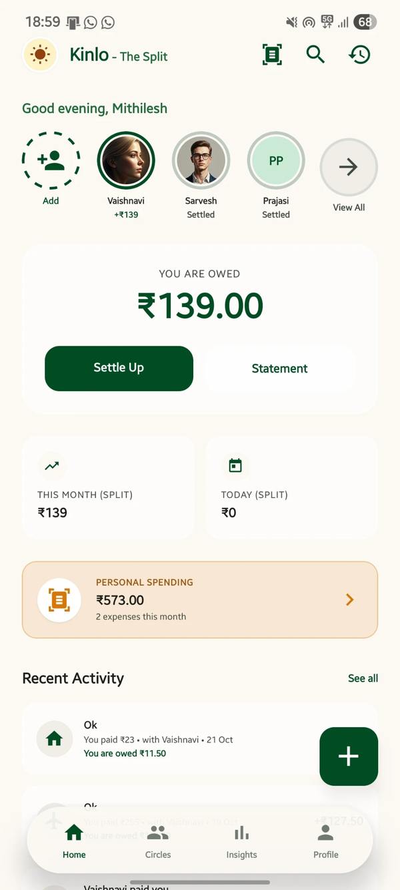
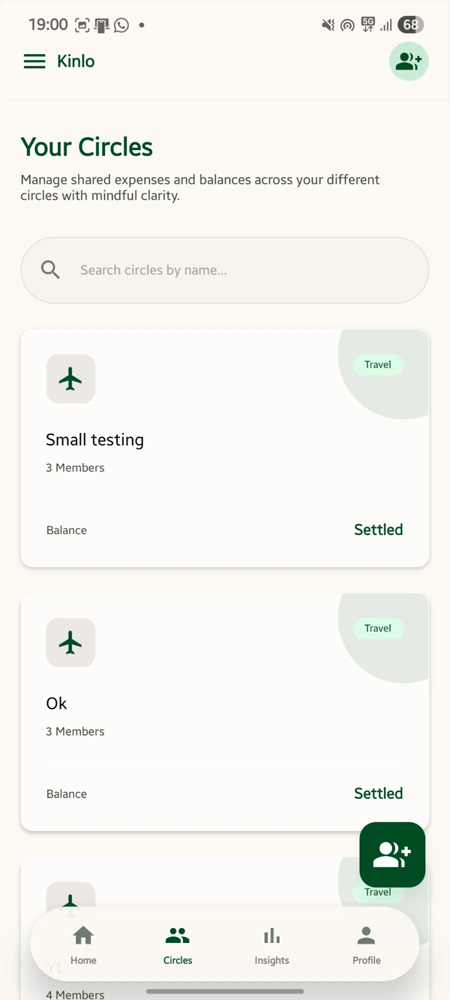
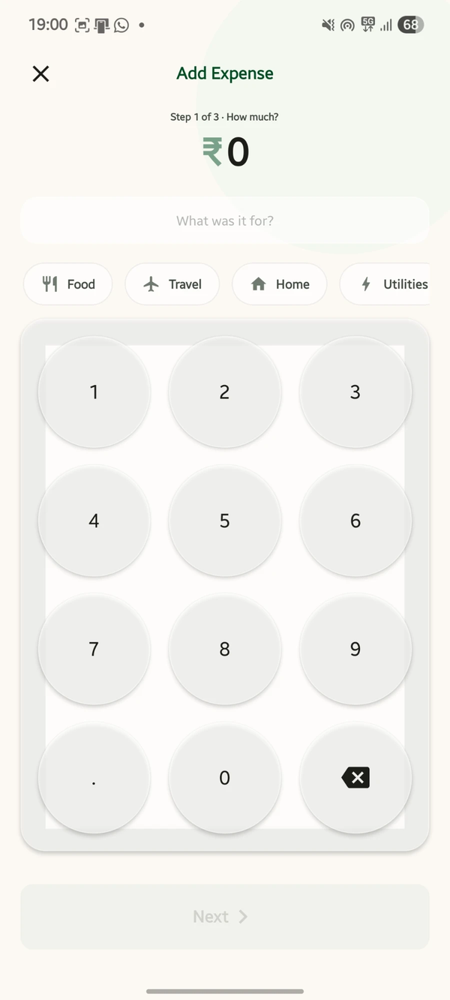
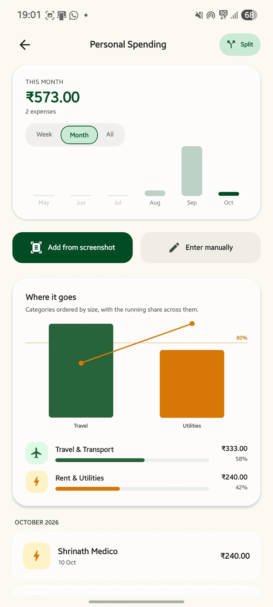
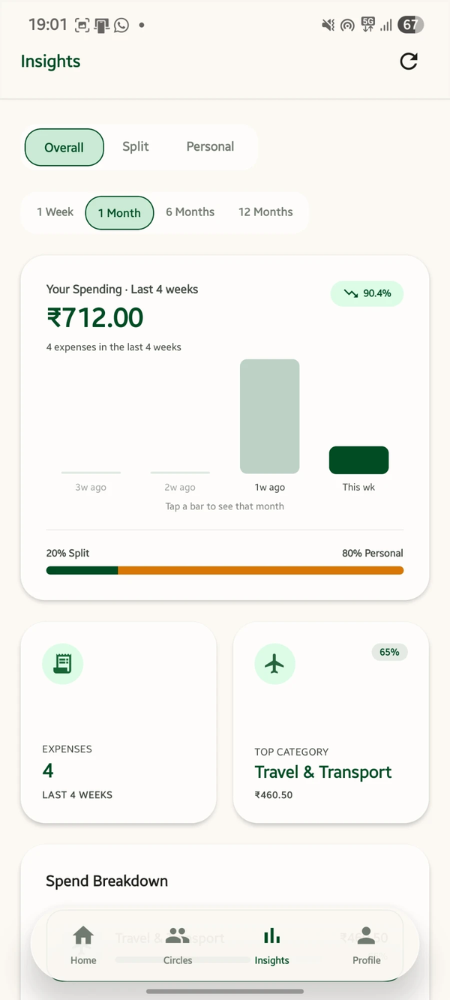

# Kinlo

**Split bills with friends and groups, scan payment screenshots, and track your own spending.**

Kinlo is an Android app (Expo / React Native) backed by Supabase. It handles shared expenses (who owes whom, settling up, debt simplification) and personal spending, including AI receipt scanning.

[**⬇ Download the preview APK**](https://github.com/Mithilesh9mk/kinlo-app/releases/latest/download/Kinlo-preview-1.0.0.apk) · Android · about 100 MB

<p align="center">
  
  
  
</p>
<p align="center">
  
  
</p>

## Features

**Split with people**
- Split an expense equally, by exact amounts, by percentage or by shares
- Balances per friend and per group, plus settle-up
- "Fewest payments" turns a group's debts into the smallest number of transfers
- Repeating expenses (rent, subscriptions) every week, month or year
- Reminders so nobody has to chase anyone

**Track your own spending**
- Scan a UPI or payment screenshot and the amount, merchant and date are filled in for you
- Quick manual entry, plus insights by category and month
- Home-screen quick-add widget: Split, Scan or Manual in one tap

## Try it

1. Open the [latest release](../../releases/latest) on your Android phone and download `Kinlo-preview-1.0.0.apk`.
2. Open the file. If Android asks, allow installs from your browser or file manager.
3. Sign up with an email address and you're in.

> Sign in with Google and Sign in with Apple aren't available yet. Use email for now.

This is a preview build (EAS `preview` profile) and gets over-the-air updates. It isn't on the Play Store yet.

## Tech stack

| Layer | Tech |
| :--- | :--- |
| App | Expo SDK 56, React Native 0.85, Expo Router, TypeScript |
| Styling | NativeWind (Tailwind CSS) |
| Backend | Supabase: Postgres, Auth, Storage, Row-Level Security |
| Server logic | Supabase Edge Functions (Deno): receipt parsing, push notifications, account deletion, billing webhook |
| AI | Receipt and screenshot extraction (Claude, with Gemini as a fallback), run server-side only |
| Builds and updates | EAS Build (APK) and EAS Update (OTA) |

## Security model

- **No secrets in the app or in this repository.** The app only ships the Supabase URL and the *anon* key. Both are public by design, and Row-Level Security decides what that key can read or write.
- **Row-Level Security on every table.** All 24 public tables have RLS enabled. There are no `USING (true)` policies and no public storage buckets. Helper functions check `auth.uid()`, so an unauthenticated caller gets nothing back.
- **AI and service keys stay on the server.** The AI provider keys, the Supabase service-role key and the billing webhook secret live in Supabase Edge Function secrets and never reach the device.
- **Every edge function checks the caller.** Each one verifies the caller's session JWT before doing any work. The billing webhook checks a shared secret with a constant-time compare.
- **Abuse limits.** Receipt scans have per-user rate limits and monthly quotas, enforced in the database.
- Schema and policy history, with the reason for each change, is in [`supabase/migrations/`](supabase/migrations).

## Run it yourself

You'll need your own Supabase project. This repository doesn't include any keys.

```bash
npm install
cp .env.example .env      # fill in EXPO_PUBLIC_SUPABASE_URL and EXPO_PUBLIC_SUPABASE_ANON_KEY
npx expo start
```

Apply `supabase/migrations/` to your project, deploy the functions in `supabase/functions/`, and set their secrets with `supabase secrets set`. [`.env.example`](.env.example) lists every variable.

## Project layout

```
app/                Expo Router screens
components/         Shared UI components
context/            React context (auth, data)
lib/                Shared logic (ledger maths, Supabase client, scheduling)
supabase/
  migrations/       Numbered SQL migrations (schema + RLS)
  functions/        Edge functions
plugins/            Expo config plugins (Android widget)
```

## About

Built by Mithilesh with [Claude Code](https://claude.com/claude-code).

© 2026 Mithilesh. All rights reserved. The source is public for viewing only; see [LICENSE](LICENSE).
